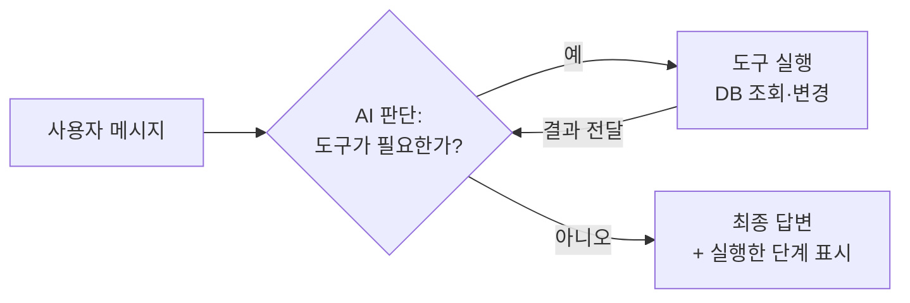
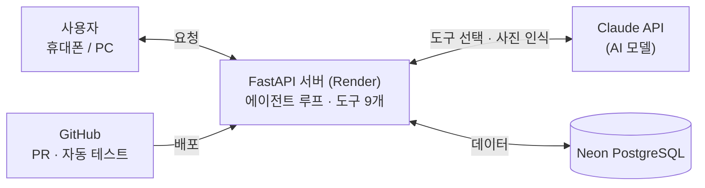

# FitCoach — AI 피트니스 코치 에이전트

**[한국어](#한국어) · [Монгол](#монгол-хэлээр)**

캡스톤디자인 2026-2 · 5조 (4명)

| | |
|---|---|
| 🌐 **서비스** | https://fitcoach-nl0o.onrender.com (무료 서버라 첫 접속은 약 50초 걸릴 수 있습니다) |
| 🤖 **에이전트 코드** | [`app/agent/`](app/agent/) · 자세한 설명: [docs/AGENT.md](docs/AGENT.md) |
| ✅ **자동 테스트** | 75개 · GitHub Actions에서 PR마다 실행 |

## 한국어

### 1. 한 줄 소개

FitCoach는 대학생을 위한 **AI 피트니스 코치**입니다. 사용자가 채팅으로 말하면 AI가 **스스로 판단해 필요한 기능(도구)을 실행하고, 운동 계획·기록을 실제로 바꿉니다.** 냉장고 사진을 올리면 재료를 인식해 목표 칼로리에 맞는 레시피를 추천합니다.

> 예: "이번 주 시험이라 바빠요. 금요일 운동을 20분으로 줄여 줘" → AI가 일정을 기억하고, 금요일 운동 계획을 직접 수정합니다.

### 2. 무엇을 할 수 있나요

| 화면 | 기능 |
|---|---|
| 시작 | 이름·나이·목표(감량 / 근육 증가 / 건강 유지)·수준 입력 → **주간 운동 계획 자동 생성** |
| 홈 | 오늘의 운동, 목표 칼로리·단백질, 레벨·연속 기록, 로봇 코치 |
| 운동 | 요일별 계획, 운동별 그림 설명, 완료 체크 시 경험치(XP) |
| 식단 | 냉장고 사진(갤러리·카메라) → **재료 인식** → 레시피 2–3개(칼로리·단백질·조리 순서) |
| 진행 | 체중 그래프, 운동한 날 |
| 채팅 | **AI 코치(에이전트)**와 대화. AI가 실행한 도구가 답변 아래에 단계로 표시 |
| 프로필 | 정보 수정, AI가 기억한 내용 확인·삭제, 언어(한국어·English·몽골어), 다크 모드 |

### 3. 1분 체험 방법

1. 서비스 접속 → **「데모 계정으로 둘러보기」** 클릭 (가입 없이 3주 사용 기록이 있는 계정)
2. **채팅**에 입력: **"금요일 운동을 20분 안에 끝나게 줄여 줘"**
3. 답변 아래에 AI가 실행한 단계가 표시됩니다 → **운동** 화면에서 금요일 계획이 **실제로 바뀐 것**을 확인
4. 운동이 있는 날 **"오늘 운동 다 했어요"** 입력 → 오늘 운동이 완료로 체크되고 +40 XP
5. **식단** 화면에서 냉장고 사진 업로드 → 재료 인식과 레시피 추천

### 4. 어떻게 동작하나요 — AI 에이전트

#### 일반 챗봇과의 차이

| | 일반 챗봇 | FitCoach 에이전트 |
|---|---|---|
| 하는 일 | 텍스트로 답변만 | 도구를 실행해 **데이터를 실제로 변경** |
| 단계 | 질문 1개 → 답변 1개 | 도구 결과를 보고 **다시 판단**, 최대 6단계 반복 |
| 정보 | 추측해서 답변 | 사용자의 계획·기록을 **직접 조회**해서 답변 |
| 기억 | 대화가 끝나면 잊음 | 일정·선호를 **저장**해 다음 대화에서도 활용 |

#### 동작 순서 (에이전트 루프)



1. 서버가 사용자 메시지 + 저장된 기억 + 최근 대화 + 규칙(시스템 프롬프트)을 AI 모델에 보냅니다.
2. AI가 필요한 도구를 고르면, **서버가 그 도구(파이썬 함수)를 실행**합니다 — DB를 읽거나 바꿉니다.
3. 실행 결과를 다시 AI에게 전달하고, AI가 다음 행동을 판단합니다.
4. 더 이상 도구가 필요 없으면 최종 답변을 보냅니다. (최대 6단계, `MAX_TURNS = 6`)

**실제 예시:** "오늘 운동 다 했어요" → AI가 `mark_workout_done` 실행 → 오늘 운동 4개를 완료로 기록, +40 XP → "오늘 운동 완료로 기록했어요! 푸시업, 트라이셉스 딥, 스쿼트, 런지를 마쳤어요."

#### 도구 9개 (`app/agent/tools.py`)

| 도구 | 하는 일 | 종류 |
|---|---|---|
| `get_user_profile` | 나이·체중·목표·레벨 조회 | 조회 |
| `get_workout_plan` | 주간 운동 계획 조회 | 조회 |
| `get_workout_history` | 운동 기록 조회 | 조회 |
| `get_progress` | 체중 변화 조회 | 조회 |
| `update_workout_day` | 특정 요일 운동 **수정** | 변경 |
| `log_weight` | 체중 **기록** | 변경 |
| `mark_workout_done` | 오늘 운동을 **완료로 기록** + XP | 변경 |
| `save_memory` | 일정·선호·주의사항 **기억** | 기억 |
| `forget_memory` | 기억 **삭제** | 기억 |

새 도구를 추가할 때는 ① AI가 읽는 설명(`TOOLS`) ② 실행 코드(`run_tool`) ③ 테스트 — 세 곳만 작성하면 됩니다. `mark_workout_done`은 이렇게 팀에서 추가했습니다.

#### 안전·신뢰 규칙

- 가슴 통증 등 위험 신호 → 운동 중단, 119 안내
- 주 1kg 초과 감량, 지나친 저열량 계획은 만들지 않음
- 도구가 **성공했을 때만** "변경했다"고 답변 (거짓 보고 방지)
- 사용자별 하루 AI 사용 한도 (비용 관리) · API 키가 없으면 **데모 모드**(규칙 기반)로 동작

#### 냉장고 사진 → 레시피 (`app/agent/fridge.py`)

1. 휴대폰에서 사진을 약 1MB로 자동 축소해 전송
2. AI가 사진을 보고(vision) 재료를 인식 — 사용자의 목표 칼로리·단백질·기억(싫어하는 음식 등)을 함께 고려
3. 정해진 형식(이름·칼로리·단백질·시간·순서)으로 레시피를 받고, 잘못된 결과(0 kcal 등)는 걸러냄

### 5. 시스템 구조



AI 모델(Claude API)은 **판단**만 담당하고, 데이터 조회·변경은 모두 팀이 작성한 서버 코드가 수행합니다. AI는 DB에 직접 접근할 수 없고, 허용된 9개 도구로만 행동합니다.

| 구성 | 기술 |
|---|---|
| 프론트엔드 | HTML (Jinja2), Tailwind CSS, JavaScript |
| 백엔드 | Python, FastAPI |
| AI 모델 | Claude API (tool use, vision) |
| 데이터베이스 | Neon PostgreSQL (로컬 실행 시 SQLite) |
| 배포 / CI | Render, GitHub Actions |
| 디자인 | Figma (색상·텍스트 스타일·버튼 디자인 시스템) |

### 6. 코드 구성

| 위치 | 역할 |
|---|---|
| [`app/agent/coach.py`](app/agent/coach.py) | **에이전트 루프**, 규칙(시스템 프롬프트), 기억 연결, 데모 모드 |
| [`app/agent/tools.py`](app/agent/tools.py) | **도구 9개**의 설명과 실행 코드 |
| [`app/agent/fridge.py`](app/agent/fridge.py) | 냉장고 사진 → 재료 → 레시피 |
| [`app/agent/llm.py`](app/agent/llm.py) | AI 모델 연결 (API 키 없으면 데모 모드) |
| [`app/main.py`](app/main.py) | 화면·API 라우트, 로그인, 사용 한도 |
| [`app/planner.py`](app/planner.py) | 목표·수준에 따른 첫 운동 계획, 칼로리 계산 |
| [`app/db.py`](app/db.py) | 데이터베이스 (사용자, 계획, 체중, 기록, 기억, 채팅, 레시피, XP) |
| [`app/xp.py`](app/xp.py) | 경험치·레벨·연속 기록 |
| [`app/i18n.py`](app/i18n.py) | 한국어·English·몽골어 |
| [`app/templates/`](app/templates/), [`app/static/`](app/static/) | 화면 (HTML, CSS, JavaScript) |
| [`tests/test_app.py`](tests/test_app.py) | 자동 테스트 75개 |

### 7. 테스트 결과 (실제 휴대폰 + Claude API)

| 테스트 | 결과 | 개선 |
|---|---|---|
| 채팅 질문 7종 | 6개 처음부터 정답 | 새 체중 기록 후 불필요한 사과를 하던 문제 수정 |
| 실제 냉장고 사진 5장 | 개선 후 주요 식재료 약 80–90% 정확히 인식 | 긴·불확실한 이름, 잘린 레시피(0 kcal), 오역, 언어 혼합 수정 |
| 갤러리 업로드 | 13.7MB 사진 → 1MB로 축소 후 정상 동작 | — |
| 기억 삭제 | "잊어 줘" 요청 시 정상 삭제 | — |
| 운동 완료 도구 | "오늘 운동 다 했어요" → 4개 완료 기록, +40 XP | — |

자세한 기록: [Issue #7](https://github.com/Erdenetogs/fitness-coach-ai-agent-v2/issues/7)

### 8. 직접 실행하기

```bash
python -m venv .venv
.venv\Scripts\activate            # Mac/Linux: source .venv/bin/activate
pip install -r requirements-dev.txt
uvicorn app.main:app --reload      # http://127.0.0.1:8000
python -m unittest                 # 테스트 75개
```

`.env`에 `ANTHROPIC_API_KEY`를 넣으면 실제 AI로, 없으면 데모 모드로 동작합니다. (보안상 API 키는 GitHub에 올리지 않습니다.)

### 9. 팀 구성

| 역할 | 담당 |
|---|---|
| 1 — UI/UX (팀장) | 화면 디자인, Figma 디자인 시스템, 사용성 테스트 |
| 2 — 프론트엔드 | 화면 동작(JavaScript), 사진 업로드, 채팅 화면 |
| 3 — 백엔드 | FastAPI 서버, 데이터베이스, Render·Neon 배포 |
| 4 — AI 에이전트 | 에이전트 루프, 도구, 시스템 프롬프트, 에이전트 테스트 |

---

## Монгол хэлээр

Капстоун дизайн 2026-2 · 5-р баг (4 хүн)

Хэрэглэгчийн зорилгоор долоо хоногийн дасгалын төлөвлөгөө гаргаж, чатаар хүссэн өөрчлөлтийг **агент өөрөө хэрэгсэл дуудаж** хийдэг, хөргөгчний зургаас жор санал болгодог веб апп.

## Холбоосууд

| Хэрэгсэл | Юунд | Холбоос |
|---|---|---|
| **Апп** | Ажиллаж буй сайт | https://fitcoach-nl0o.onrender.com |
| **GitHub** | Код, PR, ажлын жагсаалт (Issues + Milestones) | [Issues](https://github.com/Erdenetogs/fitness-coach-ai-agent-v2/issues) · [Milestones](https://github.com/Erdenetogs/fitness-coach-ai-agent-v2/milestones) |
| **GitHub Actions** | PR бүрт тест (SQLite + Postgres), сайтыг сэрүүн байлгах | [Actions](https://github.com/Erdenetogs/fitness-coach-ai-agent-v2/actions) |
| **Render** | Сервер. `main`-д merge хийсний дараа **Manual Deploy → Deploy latest commit** | dashboard.render.com |
| **Neon** | PostgreSQL өгөгдлийн сан (`DATABASE_URL`) | console.neon.tech |
| **Anthropic Console** | Claude API түлхүүр, зардал, spending limit | console.anthropic.com |
| **Figma** | Дизайн систем (өнгө, текст стиль, Button) | [FitCoach — Design System](https://www.figma.com/design/fKZk2NEXCnJI5hDIdeBEIg) |
| **Agent notebook** | Агентыг алхам алхмаар бүтээх (Colab, Gemini) | [Colab-д нээх](https://colab.research.google.com/github/Erdenetogs/fitness-coach-ai-agent-v2/blob/main/notebooks/agent_basics.ipynb) |
| **Usability test** | Заавар, хүснэгт (Claude Doc) | [Usability test](https://claude.ai/artifact/JWYwCxDeGkZAmA7bcs9P7c) |

Нууц мэдээлэл (`ANTHROPIC_API_KEY`, `DATABASE_URL`) зөвхөн Render-ийн **Environment** болон локал `.env`-д байна — GitHub, чат, screenshot-д хэзээ ч бүү оруул.

### Хугацаа (Milestones)

| Milestone | Хугацаа | Issue |
|---|---|---|
| ✅ MVP | 11/16 | — |
| Туршилт | 11/30 | #4 usability test · #5 iPhone, демо видео |
| Тайлан ба видео | 12/7 | #6 backend · #7 агент · #33 тайлан, слайд, 결과보고 |
| 🎤 Илтгэл | 12/10 | #33 |


## Бүтэц

```
README.md            Энэ файл
notebooks/agent_basics.ipynb  Агентын үндэс (Colab): tool → function calling → agent loop → санах ой
docs/
  DATA.md            API-ийн хүсэлт/хариуны хэлбэр
  DEPLOY.md          Render + Neon дээр байршуулах заавар
  TEAM.md            Багийн ажлын төлөв, хуваарь
tests/test_app.py    Автомат тестүүд
app/
  main.py            Хуудас ба API route-ууд (FastAPI)
  db.py              Өгөгдлийн сан: локал дээр SQLite (fitcoach.db), DATABASE_URL байвал PostgreSQL (Neon)
  planner.py         Анхны дасгалын төлөвлөгөө, калорийн тооцоо (дүрэмд суурилсан)
  agent/
    llm.py           Claude API холболт
    tools.py         Агентын хэрэгслүүд + "агентын алхам"-ын текст
    coach.py         Чатын агент (tool-use loop) + демо горим
    fridge.py        Зураг → орц → жор (vision + structured output)
  i18n.py            Монгол / English / 한국어 орчуулга, хэл сонгох
  demo.py            Демо хэрэглэгч (3 долоо хоногийн түүхтэй)
  xp.py              XP, level, streak
  auth.py            Нэвтрэх: нууц үгийн hash (scrypt), имэйл шалгах, олон буруу оролдлогыг хаах
  templates/         Jinja2 хуудсууд (base.html + 7 хуудас, _sidebar.html = компьютерийн цэс)
  static/css/app.css Дизайн токенууд (Figma-тай ижил)
  static/js/common.js fetch, toast, агентын алхам, t() орчуулга
```

## Хэл ба дэлгэцийн хэмжээ

- **Хэл:** Монгол / English / 한국어. Компьютер дээр зүүн цэсний доор, утсан дээр нүүр, профайл, бүртгэлийн хуудсанд солих товч бий.
  Сонголт `fitcoach_lang` cookie-д хадгалагдана. Анх ороход браузерын хэлээр (ko → 한국어, en → English), бусад үед Монгол.
- **Шинэ текст нэмэх:** `app/i18n.py`-ийн `STRINGS`-д `"түлхүүр": ("Монгол", "English", "한국어")` нэмээд template-д `{{ t('түлхүүр') }}`.
  JavaScript-д хэрэгтэй бол түлхүүрийг `js.`-ээр эхлүүлж, JS дотор `t("js.түлхүүр")` гэж дуудна.
- Дасгалын нэр, гарагийн нэр, өдрийн гарчиг өгөгдлийн санд Монголоор хадгалагдаж, харуулахдаа орчуулагдана.
  AI дасгалжуулагч сонгосон хэлээр хариулна.
- **Харагдац:** Систем / Цайвар / Харанхуй (профайл хуудас, компьютерийн цэс). Өнгөнүүд `app.css`-ийн `--*-rgb` хувьсагчид байгаа —
  шинэ өнгө хэрэглэхдээ `bg-white`, `#hex` биш `bg-surface`, `text-ink` гэх мэт token ашиглана, эс бөгөөс харанхуй горимд эвдэрнэ.
- **Дэлгэц:** 1024px-ээс өргөн бол зүүн талд цэс, агуулга 2–3 баганаар. Түүнээс нарийн (утас) бол доод цэстэй нэг багана.

## Агент юугаараа энгийн чатботоос ялгаатай вэ

| Шинж | Хаана |
|---|---|
| **Хэрэгсэл ашиглах** — төлөвлөгөө унших/өөрчлөх, жин бүртгэх, түүх шалгах | `agent/tools.py` |
| **Төлөвлөх ба давталт** — хэрэгслийн үр дүнг хараад дахин шийдвэр гаргана (6 хүртэл алхам) | `agent/coach.py` → `_chat_live` |
| **Санах ой** — гэмтэл, дуршлыг хадгалж дараагийн хариунд ашиглана | `save_memory`, system prompt |
| **Харагдах байдал** — дуудсан хэрэгсэл бүр чат дээр "агентын алхам" болж харагдана | `agent_steps` |

## XP ба level

Coach хэрэглэгчтэй хамт "өсдөг" (санаа: Erdenetogs-ийн Spring Boot хувилбар, `app/xp.py`).

- Өнөөдрийн дасгалыг бүгдийг дуусгах **+40 XP** · Жор хадгалах **+15 XP** · Өдрийн анхны чат **+5 XP**
- Level N → N+1: N × 100 XP. Шат: Загвар 1 (1–2), Загвар 2 (3–4), Загвар 3 (5–7), Аварга (8+)
- Coach нь робот: шат ахих бүрт их бие, гар, чихэвч, алтан эд анги нэмэгдэнэ. Хэрэглэгчийн зорилгоос хамаарч гүйгч / гантельтай / усны савтай төрөл гарна (`app/mascot.py`)
- Өгөгдлийн санд (`xp_events`) хадгална — ижил үйлдлээр давхар XP авахгүй. Агент `get_user_profile`-оор level-ийг мэднэ.

## Багийн ажлын хуваарь

| Гишүүн | Гол файлууд |
|---|---|
| 1 — UI/UX | `templates/`, `static/css/app.css`, Figma |
| 2 — Frontend JS | `static/js/`, хуудас бүрийн `` |
| 3 — Backend | `main.py`, `db.py`, deploy |
| 4 — AI агент | `agent/`, `planner.py` |

**Ажиллах дүрэм:** `main`-аас богино настай branch үүсгэнэ (`feature/...`, `fix/...`) → PR → тест ногоон болмогц merge → branch-аа устгана. Дэлгэрэнгүй: [docs/TEAM.md](docs/TEAM.md).

API-ийн хүсэлт/хариуны хэлбэрийг [docs/DATA.md](docs/DATA.md)-аас харна. Хэлбэр өөрчлөх бол түүнийг шинэчлээд багтаа мэдэгдэнэ.
