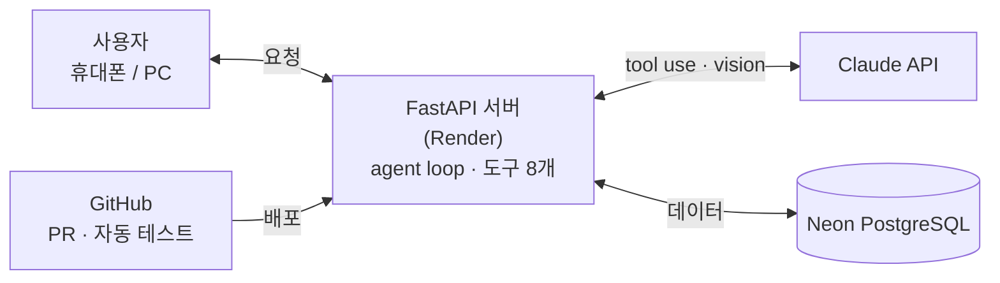

# FitCoach — AI 피트니스 코치 에이전트

**[한국어](#한국어) · [Монгол](#монгол-хэлээр)**

**🌐 서비스 주소: https://fitcoach-nl0o.onrender.com** (무료 서버라 15분 동안 사용이 없으면 잠들며, 첫 접속은 약 50초 걸립니다)

## 한국어

캡스톤디자인 2026-2 · 5조 (4명)

대학생을 위한 **AI 피트니스 코치 웹 앱**입니다. 사용자가 목표(감량·근육 증가·건강 유지)를 입력하면 주간 운동 계획을 만들고, 채팅으로 요청하면 **AI 에이전트가 스스로 도구를 호출해 계획을 실제로 수정**합니다. 냉장고 사진을 올리면 재료를 인식해 목표 칼로리에 맞는 레시피를 추천합니다. 한국어 · English · 몽골어를 지원합니다.

### 주요 기능

| 화면 | 기능 |
|---|---|
| 회원가입 / 로그인 | 이메일·비밀번호 가입, 목표·수준 입력. **데모 사용자** 버튼으로 3주 기록이 있는 계정 체험 |
| 홈 | 오늘의 운동, 목표 칼로리, 레벨·연속 기록(streak), 로봇 코치 |
| 운동 | 주간 계획, 운동별 그림 설명, 완료 체크 시 XP |
| 식단 | 냉장고 사진(갤러리·카메라) → 재료 인식 → 레시피 2–3개(칼로리·단백질) |
| 진행 | 체중 그래프, 운동한 날 |
| 채팅 | AI 코치와 대화: 운동 변경, 체중 기록, 진행 상황 질문. 에이전트가 수행한 단계를 답변 아래에 표시 |
| 프로필 | 정보 수정, 기억(메모리) 확인·삭제, 언어, 라이트/다크 모드 |

### AI 에이전트 — 일반 챗봇과의 차이

| | 일반 챗봇 | FitCoach 에이전트 |
|---|---|---|
| 하는 일 | 텍스트로만 답변 | 도구를 호출해 **데이터베이스를 실제로 변경** (운동 계획 수정, 체중 기록) |
| 단계 | 질문 1개 → 답변 1개 | 도구 결과를 보고 다시 판단, 최대 6단계 (**agent loop**) |
| 기억 | 대화가 끝나면 잊음 | 일정·선호 등을 저장해 다음 대화에서도 활용 |
| 투명성 | 무엇을 했는지 보이지 않음 | 호출한 도구가 답변 아래 단계로 표시 |

**도구 8개** (`app/agent/tools.py`): 프로필 조회, 운동 계획 조회, 운동 기록 조회, 진행 상황 조회, 요일별 운동 변경, 체중 기록, 기억 저장, 기억 삭제.

에이전트 루프, 도구, 기억, 안전 규칙은 LangChain 같은 프레임워크 없이 직접 구현했습니다. Claude API는 판단을 담당하는 "두뇌"로만 사용합니다.

**안전 규칙:** 가슴 통증 시 운동 중단 및 119 안내, 주 1kg 초과 감량·과도한 저열량 계획 금지, 도구가 성공했을 때만 "변경했다"고 답변, 사용자별 하루 AI 사용 한도.

### 시스템 구조



| 구성 | 기술 |
|---|---|
| 프론트엔드 | HTML (Jinja2), Tailwind CSS, JavaScript |
| 백엔드 | Python, FastAPI |
| AI | Claude API (tool use, vision, structured output) |
| 데이터베이스 | Neon PostgreSQL (로컬은 SQLite) |
| 배포 | Render |
| 디자인 | Figma (디자인 시스템: 색상·텍스트 스타일·버튼) |
| 테스트 / CI | unittest 68개, GitHub Actions (SQLite + PostgreSQL) |

### 테스트 결과 (2026-11-16, 실제 휴대폰 + Claude API)

| 테스트 | 결과 | 개선 |
|---|---|---|
| 채팅 질문 7종 | 6개 처음부터 정답 | 새 체중 기록 후 불필요한 사과를 하던 문제 수정 |
| 실제 냉장고 사진 5장 | 개선 후 주요 식재료의 약 80–90% 정확히 인식 | 긴 이름·불확실한 이름·잘린 레시피(0 kcal)·오역 수정 |
| 갤러리 업로드 | 13.7MB 사진 → 1MB로 자동 축소 후 정상 동작 | — |
| 기억 삭제 | "잊어 줘" 요청 시 정상 삭제 | — |

자세한 기록: [Issue #7](https://github.com/Erdenetogs/fitness-coach-ai-agent-v2/issues/7)

### 실행 방법

```bash
python -m venv .venv
.venv\Scripts\activate          # Mac/Linux: source .venv/bin/activate
pip install -r requirements.txt
uvicorn app.main:app --reload    # http://127.0.0.1:8000
```

`ANTHROPIC_API_KEY`가 없으면 **데모 모드**로 동작합니다(규칙 기반 응답, 도구는 실제로 실행). 테스트: `pip install -r requirements-dev.txt` → `python -m unittest -v`

### 팀 구성

| 역할 | 담당 |
|---|---|
| 1 — UI/UX (팀장) | 화면 디자인, Figma 디자인 시스템, 사용성 테스트 |
| 2 — 프론트엔드 | 화면 동작(JavaScript), 사진 업로드, 채팅 화면 |
| 3 — 백엔드 | FastAPI 서버, 데이터베이스, Render·Neon 배포 |
| 4 — AI 에이전트 | Claude API 연동, 도구, 시스템 프롬프트, 에이전트 테스트 |

### 일정

| 마일스톤 | 기한 |
|---|---|
| ✅ MVP | 11/16 |
| 사용성 테스트·개선 | 11/30 |
| 보고서·슬라이드·데모 영상 | 12/7 |
| 🎤 발표 | 12/10 |

---

## Монгол хэлээр

Капстоун дизайн 2026-2 · 5-р баг (4 хүн)

Хэрэглэгчийн зорилгоор долоо хоногийн дасгалын төлөвлөгөө гаргаж, чатаар хүссэн өөрчлөлтийг **агент өөрөө хэрэгсэл дуудаж** хийдэг, хөргөгчний зургаас жор санал болгодог веб апп.

## Холбоосууд

| Хэрэгсэл | Юунд | Холбоос |
|---|---|---|
| **Апп** | Ажиллаж буй сайт | https://fitcoach-nl0o.onrender.com |
| **GitHub** | Код, PR, ажлын жагсаалт (Issues + Milestones) | [Issues](https://github.com/Erdenetogs/fitness-coach-ai-agent-v2/issues) · [Milestones](https://github.com/Erdenetogs/fitness-coach-ai-agent-v2/milestones) |
| **GitHub Actions** | PR бүрт тест (SQLite + Postgres), сайтыг сэрүүн байлгах | [Actions](https://github.com/Erdenetogs/fitness-coach-ai-agent-v2/actions) |
| **Render** | Сервер. `main`-д merge хийсний дараа **Manual Deploy → Deploy latest commit** | dashboard.render.com |
| **Neon** | PostgreSQL өгөгдлийн сан (`DATABASE_URL`) | console.neon.tech |
| **Anthropic Console** | Claude API түлхүүр, зардал, spending limit | console.anthropic.com |
| **Figma** | Дизайн систем (өнгө, текст стиль, Button) | [FitCoach — Design System](https://www.figma.com/design/fKZk2NEXCnJI5hDIdeBEIg) |
| **Agent notebook** | Агентыг алхам алхмаар бүтээх (Colab, Gemini) | [Colab-д нээх](https://colab.research.google.com/github/Erdenetogs/fitness-coach-ai-agent-v2/blob/main/notebooks/agent_basics.ipynb) |
| **Usability test** | Заавар, хүснэгт (Claude Doc) | [Usability test](https://claude.ai/artifact/JWYwCxDeGkZAmA7bcs9P7c) |

Нууц мэдээлэл (`ANTHROPIC_API_KEY`, `DATABASE_URL`) зөвхөн Render-ийн **Environment** болон локал `.env`-д байна — GitHub, чат, screenshot-д хэзээ ч бүү оруул.

### Хугацаа (Milestones)

| Milestone | Хугацаа | Issue |
|---|---|---|
| ✅ MVP | 11/16 | — |
| Туршилт | 11/30 | #4 usability test · #5 iPhone, демо видео |
| Тайлан ба видео | 12/7 | #6 backend · #7 агент · #33 тайлан, слайд, 결과보고 |
| 🎤 Илтгэл | 12/10 | #33 |

## Асаах (Windows, VS Code terminal)

```bash
python -m venv .venv
.venv\Scripts\activate          # Mac/Linux: source .venv/bin/activate
pip install -r requirements.txt
copy .env.example .env          # Mac/Linux: cp .env.example .env
uvicorn app.main:app --reload
```

- Сайт: http://127.0.0.1:8000
- Тест: `pip install -r requirements-dev.txt` → `python -m unittest -v` (PR бүрт GitHub Actions автоматаар ажиллуулна)
- Сервер байршуулах: [docs/DEPLOY.md](docs/DEPLOY.md)
- API туршилт: http://127.0.0.1:8000/docs

`.env` дотор `ANTHROPIC_API_KEY` байхгүй бол агент **демо горим**-оор ажиллана: бодит хэрэгслүүдийг дуудаж өгөгдлийн санг өөрчилдөг ч хариуг энгийн дүрмээр гаргана. Түлхүүр тавимагц Claude жинхэнэ агент болж ажиллана.

## Бүтэц

```
README.md            Энэ файл
notebooks/agent_basics.ipynb  Агентын үндэс (Colab): tool → function calling → agent loop → санах ой
docs/
  DATA.md            API-ийн хүсэлт/хариуны хэлбэр
  DEPLOY.md          Render + Neon дээр байршуулах заавар
  TEAM.md            Багийн ажлын төлөв, хуваарь
tests/test_app.py    Автомат тестүүд
app/
  main.py            Хуудас ба API route-ууд (FastAPI)
  db.py              Өгөгдлийн сан: локал дээр SQLite (fitcoach.db), DATABASE_URL байвал PostgreSQL (Neon)
  planner.py         Анхны дасгалын төлөвлөгөө, калорийн тооцоо (дүрэмд суурилсан)
  agent/
    llm.py           Claude API холболт
    tools.py         Агентын хэрэгслүүд + "агентын алхам"-ын текст
    coach.py         Чатын агент (tool-use loop) + демо горим
    fridge.py        Зураг → орц → жор (vision + structured output)
  i18n.py            Монгол / English / 한국어 орчуулга, хэл сонгох
  demo.py            Демо хэрэглэгч (3 долоо хоногийн түүхтэй)
  xp.py              XP, level, streak
  auth.py            Нэвтрэх: нууц үгийн hash (scrypt), имэйл шалгах, олон буруу оролдлогыг хаах
  templates/         Jinja2 хуудсууд (base.html + 7 хуудас, _sidebar.html = компьютерийн цэс)
  static/css/app.css Дизайн токенууд (Figma-тай ижил)
  static/js/common.js fetch, toast, агентын алхам, t() орчуулга
```

## Хэл ба дэлгэцийн хэмжээ

- **Хэл:** Монгол / English / 한국어. Компьютер дээр зүүн цэсний доор, утсан дээр нүүр, профайл, бүртгэлийн хуудсанд солих товч бий.
  Сонголт `fitcoach_lang` cookie-д хадгалагдана. Анх ороход браузерын хэлээр (ko → 한국어, en → English), бусад үед Монгол.
- **Шинэ текст нэмэх:** `app/i18n.py`-ийн `STRINGS`-д `"түлхүүр": ("Монгол", "English", "한국어")` нэмээд template-д `{{ t('түлхүүр') }}`.
  JavaScript-д хэрэгтэй бол түлхүүрийг `js.`-ээр эхлүүлж, JS дотор `t("js.түлхүүр")` гэж дуудна.
- Дасгалын нэр, гарагийн нэр, өдрийн гарчиг өгөгдлийн санд Монголоор хадгалагдаж, харуулахдаа орчуулагдана.
  AI дасгалжуулагч сонгосон хэлээр хариулна.
- **Харагдац:** Систем / Цайвар / Харанхуй (профайл хуудас, компьютерийн цэс). Өнгөнүүд `app.css`-ийн `--*-rgb` хувьсагчид байгаа —
  шинэ өнгө хэрэглэхдээ `bg-white`, `#hex` биш `bg-surface`, `text-ink` гэх мэт token ашиглана, эс бөгөөс харанхуй горимд эвдэрнэ.
- **Дэлгэц:** 1024px-ээс өргөн бол зүүн талд цэс, агуулга 2–3 баганаар. Түүнээс нарийн (утас) бол доод цэстэй нэг багана.

## Агент юугаараа энгийн чатботоос ялгаатай вэ

| Шинж | Хаана |
|---|---|
| **Хэрэгсэл ашиглах** — төлөвлөгөө унших/өөрчлөх, жин бүртгэх, түүх шалгах | `agent/tools.py` |
| **Төлөвлөх ба давталт** — хэрэгслийн үр дүнг хараад дахин шийдвэр гаргана (6 хүртэл алхам) | `agent/coach.py` → `_chat_live` |
| **Санах ой** — гэмтэл, дуршлыг хадгалж дараагийн хариунд ашиглана | `save_memory`, system prompt |
| **Харагдах байдал** — дуудсан хэрэгсэл бүр чат дээр "агентын алхам" болж харагдана | `agent_steps` |

## XP ба level

Coach хэрэглэгчтэй хамт "өсдөг" (санаа: Erdenetogs-ийн Spring Boot хувилбар, `app/xp.py`).

- Өнөөдрийн дасгалыг бүгдийг дуусгах **+40 XP** · Жор хадгалах **+15 XP** · Өдрийн анхны чат **+5 XP**
- Level N → N+1: N × 100 XP. Шат: Загвар 1 (1–2), Загвар 2 (3–4), Загвар 3 (5–7), Аварга (8+)
- Coach нь робот: шат ахих бүрт их бие, гар, чихэвч, алтан эд анги нэмэгдэнэ. Хэрэглэгчийн зорилгоос хамаарч гүйгч / гантельтай / усны савтай төрөл гарна (`app/mascot.py`)
- Өгөгдлийн санд (`xp_events`) хадгална — ижил үйлдлээр давхар XP авахгүй. Агент `get_user_profile`-оор level-ийг мэднэ.

## Багийн ажлын хуваарь

| Гишүүн | Гол файлууд |
|---|---|
| 1 — UI/UX | `templates/`, `static/css/app.css`, Figma |
| 2 — Frontend JS | `static/js/`, хуудас бүрийн `` |
| 3 — Backend | `main.py`, `db.py`, deploy |
| 4 — AI агент | `agent/`, `planner.py` |

**Ажиллах дүрэм:** `main`-аас богино настай branch үүсгэнэ (`feature/...`, `fix/...`) → PR → тест ногоон болмогц merge → branch-аа устгана. Дэлгэрэнгүй: [docs/TEAM.md](docs/TEAM.md).

API-ийн хүсэлт/хариуны хэлбэрийг [docs/DATA.md](docs/DATA.md)-аас харна. Хэлбэр өөрчлөх бол түүнийг шинэчлээд багтаа мэдэгдэнэ.
