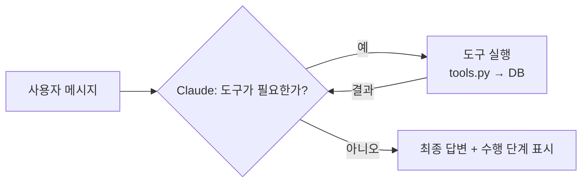

# FitCoach AI 에이전트 — 구조와 코드 위치

FitCoach의 AI 에이전트는 **[`app/agent/`](../app/agent/)** 폴더에 직접 구현되어 있습니다.
Claude API는 판단을 담당하는 언어 모델(두뇌)로만 사용하고, **에이전트 루프 · 도구 8개 · 기억 · 안전 규칙은 팀이 직접 작성**했습니다 (LangChain 등 프레임워크 미사용).

## 1. 왜 "챗봇"이 아니라 "에이전트"인가

| 에이전트의 요소 | FitCoach에서 | 코드 |
|---|---|---|
| **목표 / 역할** | 대학생 개인 피트니스 코치 (안전 규칙 포함) | [`coach.py` SYSTEM](https://github.com/Erdenetogs/fitness-coach-ai-agent-v2/blob/main/app/agent/coach.py#L20) |
| **인식** | 사용자 프로필·운동 계획·체중 기록·기억을 도구로 직접 조회, 냉장고 사진 인식(vision) | [`tools.py`](https://github.com/Erdenetogs/fitness-coach-ai-agent-v2/blob/main/app/agent/tools.py#L8), [`fridge.py`](https://github.com/Erdenetogs/fitness-coach-ai-agent-v2/blob/main/app/agent/fridge.py) |
| **판단** | 어떤 도구를 어떤 순서로 쓸지 모델이 스스로 결정 | [`coach.py` _loop](https://github.com/Erdenetogs/fitness-coach-ai-agent-v2/blob/main/app/agent/coach.py#L151) |
| **행동** | 데이터베이스를 실제로 변경: 운동 계획 수정, 체중 기록, 기억 저장·삭제 | [`tools.py` run_tool](https://github.com/Erdenetogs/fitness-coach-ai-agent-v2/blob/main/app/agent/tools.py#L141) |
| **반복 (agent loop)** | 도구 결과를 보고 다시 판단, 최대 6단계 | [`MAX_TURNS = 6`](https://github.com/Erdenetogs/fitness-coach-ai-agent-v2/blob/main/app/agent/coach.py#L17) |
| **기억** | 저장한 기억을 매 대화마다 시스템 프롬프트에 넣어 다음 대화에서도 활용 | [`_memories_text`](https://github.com/Erdenetogs/fitness-coach-ai-agent-v2/blob/main/app/agent/coach.py#L78) |
| **투명성** | 호출한 도구가 답변 아래 "단계"로 표시 | [`step_for`](https://github.com/Erdenetogs/fitness-coach-ai-agent-v2/blob/main/app/agent/tools.py#L115) |

## 2. 에이전트 루프 (핵심 코드)

```python
# app/agent/coach.py — _loop()
for _ in range(MAX_TURNS):                       # 최대 6단계
    resp = client.messages.create(system=SYSTEM, tools=TOOLS, messages=messages)
    if resp.stop_reason != "tool_use":           # 도구가 더 필요 없으면 → 최종 답변
        return {"reply": ..., "agent_steps": steps}
    for block in resp.content:                   # 모델이 고른 도구를
        out = run_tool(uid, block.name, block.input)   # 실제로 실행하고 (DB 변경)
        results.append(tool_result(out))         # 결과를 다시 모델에게 전달
    messages.append({"role": "user", "content": results})
```



## 3. 도구 8개

| 도구 | 하는 일 |
|---|---|
| `get_user_profile` | 나이·체중·목표·수준 조회 |
| `get_workout_plan` | 주간 운동 계획 조회 |
| `get_workout_history` | 운동 기록 조회 |
| `get_progress` | 체중 변화 조회 |
| `update_workout_day` | 특정 요일 운동을 **수정** |
| `log_weight` | 체중 **기록** |
| `save_memory` | 일정·선호·주의사항을 **기억에 저장** |
| `forget_memory` | 기억 **삭제** (본인 것만) |

## 4. 실제 동작 예시

사용자: **"이번 주 시험이라 바빠요. 금요일 운동을 20분 안에 끝나게 줄여 줘"**

1. `save_memory("시험 기간에 바쁨 — 운동 20분 이내")`
2. `get_workout_plan()` → 금요일 계획 확인
3. `update_workout_day("금요일", [짧은 운동 3개])` → **DB 변경**
4. 최종 답변 + 답변 아래 단계 3개 표시 → **운동** 화면에서 금요일이 실제로 바뀐 것을 확인

## 5. 직접 확인하는 방법

- 앱: https://fitcoach-nl0o.onrender.com → 「데모 계정으로 둘러보기」 → 채팅에서 위 예시 입력
- 채팅 화면 상단에 **「Claude AI 에이전트」**(실제 Claude 연결) 또는 **데모 모드**(API 키 없이 규칙 기반) 표시
- 서버 상태: https://fitcoach-nl0o.onrender.com/api/status → `"ai_live": true` 이면 실제 에이전트 동작 중
- 자동 테스트: [`tests/test_app.py`](../tests/test_app.py) (74개, 에이전트 도구·루프 포함)
